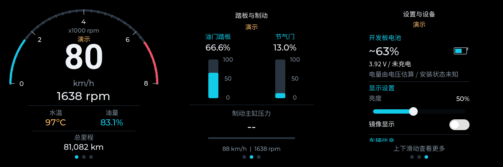
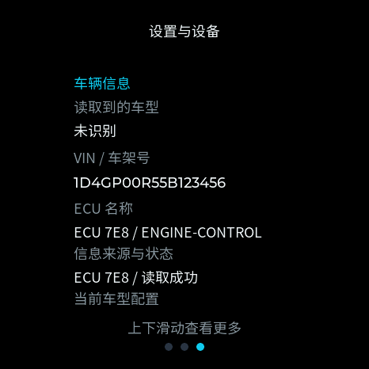
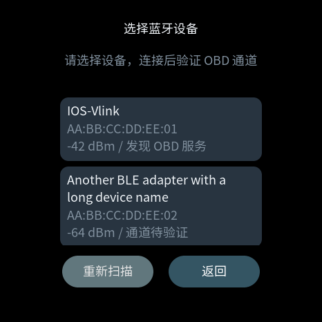
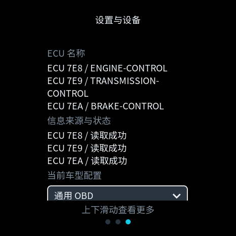

# Round OBD HUD · ESP32-S3-Touch-AMOLED-1.43C

将车辆 OBD 数据显示在 466×466 圆形 AMOLED 触摸屏上的独立仪表。ESP32-S3 通过 **IOS-Vlink BLE ELM327** 读取车辆数据，支持三屏触控、自动协议发现、演示模式与电脑诊断工具。

当前固件：**1.3.0-bluetooth.1**。固件完整源码在 [`src/hud/`](src/hud/)，应用入口是 [`runtime.cpp`](src/hud/runtime.cpp)，本仓库可直接构建，不需要另行复制原项目的代码。

> 本项目基于 [Felix Biego 的 fbiego/car-hud](https://github.com/fbiego/car-hud) 移植，基线提交为 [`fc1d22e22a8d45689488066cbeb774d109af5ae1`](https://github.com/fbiego/car-hud/commit/fc1d22e22a8d45689488066cbeb774d109af5ae1)。保留上游作者署名和 [MIT 许可证](LICENSE)。圆屏适配、现有界面、通用 OBD 控制器和电脑测试工具是在该基础上的修改，并非上游官方版本。

## 界面预览





[开机动画预览](docs/images/startup-sequence.gif) · [界面插图](docs/images/) · [详细使用说明](使用说明.md) · [实现设计](设计说明.md) · [验证记录](验证记录.md)

预览由实际 LVGL 界面在主机上渲染；VIN 示例为测试数据。图片不能反映 AMOLED 的真实面板亮度，也不能证明实机帧率。

## 功能与边界

- 三屏顺序：**仪表 → 踏板与制动 → 设置**，左右平滑切换，设置页上下惯性滚动，控件接管自身手势。
- 仪表显示车速、转速、冷却液温度、剩余油量和总里程；里程四舍五入到整数公里。
- 第二屏分别显示油门踏板、节气门与可用的制动主缸压力。节气门不能替代踏板或摩托车油门手柄。
- 设置页包含开发板电池、亮度/镜像、车辆 VIN 与 ECU 名称、蓝牙设备选择、车型/协议选择、连接信息、系统信息及辅助说明。所有文字条目按内容自动换行和增减高度。
- 首次开机扫描并选择BLE设备，验证OBD收发通道成功后保存名称、地址和地址类型；以后优先连接保存的地址，可随时从连接页或第三屏重新选择。
- 默认通用 OBD 自动发现；软件实现标准 ELM 协议 1～9 的读取路径，按 ECU 支持位图查询，稳定选择数据来源。
- 数值采用时间驱动平滑；不支持、无效或过期显示 `--`，真实零值保留。
- Logo 显示三秒：淡入 300ms、保持 2400ms、淡出 300ms；面板固定 50% 亮度，黑帧完成刷新后恢复用户保存值，再开始连接。
- 60 秒后提供重试/演示操作；失败退避、熄火等待和蓝牙断连恢复由后台状态机处理。重连不重播 Logo。
- 电脑端提供通用 PID 读取与实时仪表工具。

**软件覆盖协议不等于所有车辆已验证。** 数据是否可读，取决于车辆 ECU、网关、适配器硬件与该车型支持的 PID。当前不显示 P/R/N/D 或实际挡位；没有可靠定义的专用数据不会猜测。

## 硬件准备

|部件|要求|
|---|---|
|开发板|Waveshare **ESP32-S3-Touch-AMOLED-1.43C**，466×466，8MB Flash、8MB PSRAM|
|OBD 适配器|IOS-Vlink或提供相同GATT通道的 **BLE** ELM327兼容设备；不是经典蓝牙SPP|
|BLE 通道|服务 `18F0`，通知接收 `2AF0`，写入发送 `2AF1`，均使用 Bluetooth 基础 UUID|
|供电/烧录|USB 数据线；可选符合开发板要求的单节锂电池|
|车辆连接|汽车 OBD-II 接口；摩托车需与车型插头和针脚匹配的转接线|

开发板与适配器通过 BLE 通信，**两者之间不需要外接 CAN 线或 CAN 收发器**。适配器连接车辆诊断口。当前固件只保留这一款开发板，不能直接烧录到原项目其他板型。

板级引脚以 [`board.hpp`](src/hud/board.hpp) 为准：

|功能|GPIO|
|---|---|
|AMOLED QSPI CS / SCK|15 / 14|
|AMOLED QSPI D0 / D1 / D2 / D3|9 / 10 / 11 / 12|
|屏幕复位|13|
|触摸 SDA / SCL|47 / 48|
|触摸复位 / 中断|16 / 17|
|电池电压 / 充电状态|4 / 7|

开发板硬件与初始化参考 [Waveshare 官方项目](https://github.com/waveshareteam/ESP32-S3-Touch-AMOLED-1.43C)，其中电池与板级接口参考的 [官方示例固定版本](https://github.com/waveshareteam/ESP32-S3-Touch-AMOLED-1.43C/blob/3ac3f7f5a4f1bf7db35d85bed2bd553cd89d2a16/02_Example/arduino_v3.3.0/06_LVGL_V9_Test/esp32_s3_touch_amoled_1.43c.cpp) 可用于核对硬件。

## 快速开始：从源码构建并烧录

这是**仅含源码的仓库**：不提交预编译BIN、`.pio`、虚拟环境、运行日志与测试生成结果。README使用的少量界面插图位于`docs/images/`。字体/Logo的C资源为编译所需的静态源文件，随源码提供。

先安装 **Python 3.10+**。macOS/Linux 使用 Bash 脚本，Windows 11 使用根目录下功能对应的 PowerShell 脚本。第一次运行会在本地虚拟环境安装固定版本的 esptool、PlatformIO、板卡和库，需要联网；以后复用 `.tools` 和 `.pio` 中的缓存。

### macOS / Linux

```bash
git clone https://github.com/copfee/car-hud-143c.git
cd car-hud-143c

# 从源码构建，生成本机固件
./build.sh

# 仅校验刚生成的固件，不连接或烧录硬件
./flash.sh --verify-only

# 连接开发板后烧录：自动选择唯一 USB 串口
./flash.sh
```

有多个串口时明确指定；macOS 常见路径如下，Linux 通常为 `/dev/ttyACM0` 或 `/dev/ttyUSB0`：

```bash
./flash.sh --port /dev/cu.usbmodemXXXX --baud 460800
```

### Windows 11

在 PowerShell 中运行；不要在 `cmd.exe` 中直接执行 `.ps1`：

```powershell
git clone https://github.com/copfee/car-hud-143c.git
Set-Location car-hud-143c

# 从源码构建，生成本机固件
.\build.ps1

# 仅校验刚生成的固件，不连接或烧录硬件
.\flash.ps1 -VerifyOnly

# 连接开发板后烧录：自动选择唯一 USB 串口
.\flash.ps1
```

有多个串口时使用设备管理器中显示的 COM 端口：

```powershell
.\flash.ps1 -Port COM3 -Baud 460800
```

若系统策略禁止执行本地脚本，可只为当前 PowerShell 进程放开，然后重新运行：

```powershell
Set-ExecutionPolicy -Scope Process -ExecutionPolicy Bypass
```

- 完整镜像：`firmware/car-hud-143c-full.bin`（本地构建生成），**烧录地址 `0x0`**。
- 独立应用：`firmware/application.bin`，地址 `0x10000`，不能拿它代替完整镜像写到 `0x0`。
- 校验与版本：`firmware/SHA256SUMS`、`firmware/manifest.json`（均由本地构建生成）。
- 若连接失败，先确认 USB 线支持数据；必要时按开发板方式进入下载模式，并将波特率改为 `115200`。
- 完整镜像覆盖范围包含分区间隙，不能保证原 NVS 设置保留；烧录前记录亮度、镜像和车型选择，烧录后核对。

不用 Bash 时，也可在安装 `esptool==4.8.1` 的 Python 环境直接执行（串口按实际替换）：

```bash
python -m esptool --chip esp32s3 --port COM3 --baud 460800 write_flash --flash_mode keep --flash_freq keep --flash_size 8MB 0x0 firmware/car-hud-143c-full.bin
```

本项目是 **PlatformIO + Arduino** 工程，不是可直接运行 `idf.py build` 的原生 ESP-IDF 工程。已安装 ESP-IDF 时，可以用其中的 esptool 烧录已经生成的完整 BIN，但从源码构建仍由上述脚本调用 PlatformIO；PlatformIO 第一次使用时会下载项目锁定的框架、工具链和库。

固件不会由本仓库工具自动烧录；只有主动执行烧录命令才会写入开发板。

## 构建依赖与测试

完成上面的快速构建后，可以运行原生测试和 Python 测试。测试另外需要 CMake 3.19+、C/C++17 编译器；macOS 可使用 Command Line Tools，Linux 可使用 GCC/Clang，Windows 可使用 Visual Studio 2022 C++ Build Tools。ESP32 工具链由 PlatformIO 下载。

macOS / Linux：

```bash
./test.sh
```

Windows 11 PowerShell：

```powershell
.\test.ps1
```

`build.sh` 与 `build.ps1` 会生成车型静态表、编译 `waveshare_amoled_143c`、合并镜像并更新 SHA-256。两套脚本输出相同的 `firmware/car-hud-143c-full.bin`；`flash.sh` 与 `flash.ps1` 在烧录前都会校验清单。普通构建不需要安装 Node.js、字体转换器或 PNG 解码器，字体和 Logo 的 C 资源已经提交。`tools/reproducible_paths.py` 映射编译路径，避免在固件诊断字符串中写入本机绝对路径。

|依赖|固定版本|
|---|---|
|PlatformIO Core|6.1.18|
|Espressif32 平台|6.9.0|
|Arduino ESP32 框架包|3.20017.241212+sha.dcc1105b|
|LVGL|9.4.0|
|Arduino_GFX|1.5.7|
|SensorLib|0.3.1|
|NimBLE-Arduino|2.2.3|
|esptool|4.8.1|

配置见 [`platformio.ini`](platformio.ini)。`tools/common.sh` 和 `tools/common.ps1` 分别管理两种环境的虚拟环境；可通过 `HUD_PYTHON` 和 `PLATFORMIO_CORE_DIR` 指定自己的解释器与 PlatformIO 缓存。

只运行 Python 单元测试（不需要蓝牙设备或板卡）：

```bash
python3 -m unittest discover -v -s tests -p 'test_*.py'
```

Windows PowerShell 对应命令：

```powershell
.\.tools\venv\Scripts\python.exe -m unittest discover -v -s tests -p "test_*.py"
```

构建后可使用 `python -m platformio device monitor -b 115200` 观察串口；项目虚拟环境解释器在 macOS/Linux 为 `.tools/venv/bin/python`，Windows 为 `.tools\venv\Scripts\python.exe`。

## 开机、操作与连接恢复

1. 开机显示Logo。无有效保存记录时，Logo结束后进入蓝牙选择页，扫描附近BLE设备；选择前不启动60秒连接计时。有已保存记录时直接优先连接该地址。
2. 列表显示名称、地址、RSSI及OBD服务提示，优先列出广播18F0的设备，再按信号强度排序；未命名或未广播该服务的设备也可选择并验证。当前最多展示24个候选，可重新扫描。关闭其他占用模块的客户端，并使车辆处于可响应诊断的点火状态。
3. 选择后开始连接计时。只有18F0服务、2AF0接收、2AF1发送和通知订阅验证成功后，才将名称、地址和地址类型作为单条记录写入NVS；不要求ECU已响应，车辆未点火时也可保存适配器。连接或通道验证失败不会覆盖之前保存的设备。
4. 下次启动按保存的地址和地址类型重连，不再硬编码名称。连接页随时可点击“选择蓝牙设备”，第三屏“连接信息”中也能更换。选择页返回时保留原设备；从演示进入则返回演示，首次未选择时可返回连接页进入演示。
3. 默认通用自动模式。任一 HUD 数据有效后即可进入仪表，不强制车速与转速同时存在。
6. 左右切换三屏；第三屏上下滚动。亮度、镜像、车型与协议会保存；滑块操作不会切页。
7. 无法连接时，60 秒后出现重试/演示入口，后台继续按轮次检测。演示使用模拟车辆数值，但电池仍读取真实硬件。
8. 蓝牙断开会重新连接；15 秒无有效标准数据时等待 ECU，每 5 秒检查，连续三次失败重新发现协议。压力响应不能维持标准 ECU 在线状态。

电池电量由 GPIO4 校准电压乘二估算，GPIO7 低电平表示充电，两秒采样并滤波。硬件无法可靠判断电池是否安装，显示“状态未知”；未充电不等于已充满，异常读数为 `--`。

## 车型、协议与验证情况

|配置|默认协议与行为|目前证据与限制|
|---|---|---|
|通用 OBD|`ATSP0` 自动发现；可强制 1～9|协议解析/初始化有软件样本测试；不能据此宣称所有车型兼容|
|奔驰 C260 2021|自动发现；标准协议 7 验证后才启用压力扩展|历史实车日志存在标准协议 7 和压力协议 6 响应；当前通用固件仍需回归|

奔驰配置 ID 统一为 `mercedes-c260-2021`，界面显示“奔驰 C260 2021”。命令行、共同配置和固件生成表采用同一名称；固件持久化车型编号仍为1，已有车型选择可继续恢复。

当前仅提供通用 OBD 和奔驰 C260 2021 两种配置。设备保存的车型编号超出范围时，回退到通用 OBD／自动协议；有效车型的手动协议设置继续保留。

奔驰压力是车型扩展：标准通道协议 7，压力通道协议 6、`7E2 → 7EA`、请求 `222002`。仅显式选择奔驰配置后使用，不能作为通用压力定义推广到其他车。通用模式不启用该查询。

支持位图、可用 PID 与响应来源由当前 ECU 决定。总里程、踏板、油量、VIN 不保证每车提供；无响应时保留 `--`。车型不会根据 VIN 前缀或 ECU 名称猜测，手动配置与车载读到的身份分别展示。

默认目标间隔如下；这是调度目标，**不是承诺刷新率**：

|数据|仪表/设置页|踏板与制动页|
|---|---:|---:|
|车速|333ms|1s|
|转速|667ms|1s|
|油门踏板|2s|250ms|
|节气门|2s|500ms|
|水温|5s|5s|
|油量|10s|10s|
|总里程|30s|30s|
|奔驰压力|5s|每秒一组，每组两次|

只有一个在途命令。调度器测量往返耗时，超过 60% 预算时放宽周期；KWP/K-Line 与较慢适配器的实际刷新会更慢。车辆响应频率与画面平滑独立。

## 电脑 BLE 测试工具

```bash
python3 -m venv .tools/obd-env
.tools/obd-env/bin/python -m pip install -r diagnostics/requirements.txt
```

两个工具共用 Bleak 3.0.2 与 IOS-Vlink GATT 层，默认按 **`IOS-Vlink` 名称查找**，不含原作者电脑的设备 UUID。附近有多个同名模块时，请显式使用本机地址：`--device 地址`。macOS 的设备 UUID 与其他电脑/ESP32 的地址并不通用。macOS 首次运行需允许终端蓝牙权限。

列出附近 BLE 设备（在自己的电脑执行）：

```bash
.tools/obd-env/bin/python -c "import asyncio; from bleak import BleakScanner; print(*asyncio.run(BleakScanner.discover(timeout=8)), sep='\n')"
```

### 通用读取与实时仪表

```bash
.tools/obd-env/bin/python diagnostics/elm327_ble.py --read --extended --profile generic --log .tools/obd-read.log
.tools/obd-env/bin/python diagnostics/elm327_ble.py --live --profile generic --log .tools/obd-live.log
.tools/obd-env/bin/python diagnostics/elm327_ble.py --live --profile mercedes-c260-2021
```

支持 `--protocol auto` 或 `1…9`、`--device`、`--log` 等参数，`--help` 可查看完整选项。按支持位图读取，并低优先级读取 VIN 与 ECU 名称。终端原地更新，Ctrl+C 释放连接。

默认日志保存在项目上一级；可通过 `--log` 指定路径。

上述工具的日志可能包含 VIN、设备地址与真实响应，请自行保管，分享故障记录前遮盖。仓库不提交车辆原始日志、本机凭证、缓存、虚拟环境和构建目录。





## 源码与架构

```text
src/hud/
  runtime.cpp            Arduino入口、单一BLE任务、快照与偏好设置
  board.hpp              1.43C屏幕、触摸、电池与亮度接口
  core.hpp / core.cpp    页面/开机状态、BLE选择/保存模型、平滑及有效期
  obd.hpp / obd.cpp      ELM会话、协议策略、ECU能力/身份、调度与恢复
  ui.hpp / ui.cpp        三屏/蓝牙选择界面、Flex自适应设置布局与动态重绘
  profiles_generated.hpp 构建时从JSON生成（不入库）
  hud_cn_18.c            中文子集字体
  hud_speed_96.c         大号数字字体
  mercedes_logo.c        Flash内RGB565 Logo
  version.hpp            固件版本
config/obd_profiles.json 车型、PID、采样、压力与恢复参数的共同定义
partitions/              8MB分区表
assets/                  Logo原图/转换图与字体许可证
docs/images/             README精选界面插图
previews/                本地生成的LVGL预览（不入库）
firmware/                本地生成的BIN、清单与SHA-256（不入库）
diagnostics/            电脑BLE/PID读取与测试工具
tests/                  原生UI/控制器与Python模拟测试、报文样本
tools/                  资源生成、版本清单和打包工具
```

通信任务持有 BLE 与命令串行化；协议策略负责不同报文格式；车型表与调度器决定读取内容；界面只消费快照，不从绘制回调直接查询 ECU。车辆信息按来源重组，不平均多个 ECU 返回的不同数值。会话代次用于取消旧请求，避免迟到响应污染新连接。

添加车型或调整采样，先修改 `config/obd_profiles.json`，再运行 `python3 tools/generate_profiles.py`，补充报文样本与测试；不要直接手改生成头文件。专用 PID 需要车型证据，不能只凭另一个年款名称套用。

## 预览、资源与打包

```bash
# 先完成 ./build.sh 和 ./test.sh；生成预览额外需要 Pillow
.tools/venv/bin/python -m pip install Pillow
.tools/venv/bin/python tools/render_previews.py --native-dir .tools/native

# 替换 Logo：保留原图、生成466×466黑底图和RGB565 C资源
.tools/venv/bin/python tools/generate_logo.py --source /path/to/logo.png
./build.sh

# 打包当前项目（先通过构建，保持源码/清单一致）
.tools/venv/bin/python tools/package_release.py --output ../car-hud-143c-release.zip
```

新增中文文案时，使用 `tools/generate_fonts.py` 配合 Noto Sans SC 字体源文件和 `lv_font_conv` 重新生成子集，再构建。现成字体已包含当前界面所需字形；只改 README 无需重生成。

## 测试与未完成的硬件验收

- 原生测试共5项，覆盖模型/计时、车型设置恢复、显示刷新策略、BLE地址与持久化记录编解码、候选去重排序、选择失败保留原设备、迟到结果隔离，以及两种像素格式的蓝牙选择页、空列表、长名称、设置条目多行展开/收缩、滑动与控件手势。
- Python 当前共 23 项，覆盖协议 1～9 样本、来源隔离、VIN 重组、断连/取消，以及名称/地址发现分支。
- 共同样本与模拟 ECU 测试不等于适配器实际支持全部协议；源码已完成ESP32-S3构建与镜像校验，固件由使用者在本地生成。
- 当前发布固件尚未完成 C260 实车回归；首次扫描/选择、断电重启自动重连、更换失败保留原设备、实际NVS写入、50%亮度、物理滑动、镜像触控、USB/电池供电表现仍需硬件验收。

参见 [验证记录](验证记录.md)。测试/构建日志、机器可读运行汇总及性能数据仅在本地保留，不提交 Git。

## 常见问题

|现象|检查方式|
|---|---|
|一直连接不上|车辆是否点火、适配器供电、保存地址/地址类型和GATT是否匹配、是否被其他客户端占用；可重新选择蓝牙设备|
|升级后要求选择蓝牙|旧固件没有保存BLE记录，首次升级需选择一次；仅选择不会覆盖原亮度/镜像/车型编号|
|有蓝牙但提示不支持OBD服务|列表是附近BLE设备，固件当前仅支持18F0/2AF0/2AF1通道，不支持任意BLE协议或经典蓝牙SPP|
|设备变更随机地址后无法自动连|当前保存地址和地址类型，未实现绑定后的私有地址解析；重新扫描选择|
|切到协议6读不到奔驰标准数据|这辆车历史标准响应在协议7；协议6用于已知压力扩展，不能把两条路径直接互换|
|显示 `--`|先看支持位图、原始响应和有效期；并非所有车辆提供里程、油量或踏板|
|VIN为空、车型未识别|这些信息独立读取且并非每车提供；不会影响基础仪表，也不会用名称猜车型|
|只有USB却出现电压|板级无法可靠判定电池安装；电压估算不能作为安装检测|
|首次 `test.sh` 找不到LVGL|先执行 `./build.sh` 安装 `.pio/libdeps` 中的依赖，再测试|
|修改源码后不能打包|先构建并更新版本清单；不要随意改SHA掩盖未构建的固件代码变化|

## 未来可选性能优化：CAN 被动监听

当前版本采用主动 OBD/PID 轮询，暂时移除被动监听原型、专用测试和运行入口。未来可将CAN被动监听作为**按车型选用**的性能优化项：在具备可靠报文定义的车辆上，评估从广播中读取转速、车速、踏板等高频数据，以减少诊断请求往返和轮询开销。

启用前需核实车辆网关的报文可见性、实际总线/ID格式、信号定义、数据有效期，以及适配器吞吐量。已有IOS-Vlink测试中，全量监听发生过`BUFFER FULL`，单ID过滤可稳定采集，但尚未建立所需信号的可靠解码定义；接收频率不能直接当作仪表刷新收益。

后续可研究现成DBC/车型定义、硬件过滤、自动分组采集与候选信号验证；收益需要在同一车辆和硬件上与轮询方案对比。使用同一个ELM时，持续监听与PID查询不能并发，切换成本和失败后恢复轮询也需验证。该方向仅适用于相应CAN车辆，不替代默认通用轮询路径，也不承诺固定性能提升。

## 引用项目、致谢与许可

|项目/资源|用途与来源|
|---|---|
|[fbiego/car-hud](https://github.com/fbiego/car-hud)|原始项目、移植起点；MIT，作者 Felix Biego，原始版权声明保留在 LICENSE|
|[Waveshare ESP32-S3-Touch-AMOLED-1.43C](https://github.com/waveshareteam/ESP32-S3-Touch-AMOLED-1.43C)|开发板硬件与官方板级示例参考；不是本项目维护的固件|
|[LVGL](https://github.com/lvgl/lvgl)|界面、动画、输入与绘制|
|[Arduino_GFX](https://github.com/moononournation/Arduino_GFX)|AMOLED/QSPI绘制支持|
|[SensorLib](https://github.com/lewisxhe/SensorLib)|触摸驱动|
|[NimBLE-Arduino](https://github.com/h2zero/NimBLE-Arduino)|ESP32 BLE客户端|
|[Bleak](https://github.com/hbldh/bleak)|电脑BLE连接|
|[Noto CJK](https://github.com/notofonts/noto-cjk)|Noto Sans SC中文子集；[OFL文本](assets/fonts/Noto-OFL.txt)|
|[Roboto](https://github.com/googlefonts/roboto)|大号数字字体；[随附Apache-2.0文本](assets/fonts/Roboto-APACHE-2.0.txt)|
|[ELM327官方数据手册](https://www.elmelectronics.com/wp-content/uploads/2017/01/ELM327DS.pdf)|ELM命令、协议编号与报文格式参考|

项目代码沿用 MIT 许可，各依赖遵循自身许可证。奔驰 Logo 原图由使用者提供，相关图形/商标权利归原权利人，未纳入本项目对软件代码的 MIT 授权，也不代表奔驰或 Waveshare 官方合作/认证。需要替换图标时使用仓库内转换工具。

反馈问题时请提供开发板型号、适配器、车辆年款、所选配置/协议、复现步骤和遮盖身份信息后的响应节选，并区分“模拟测试”“电脑实车读取”和“该固件实车测试”。
